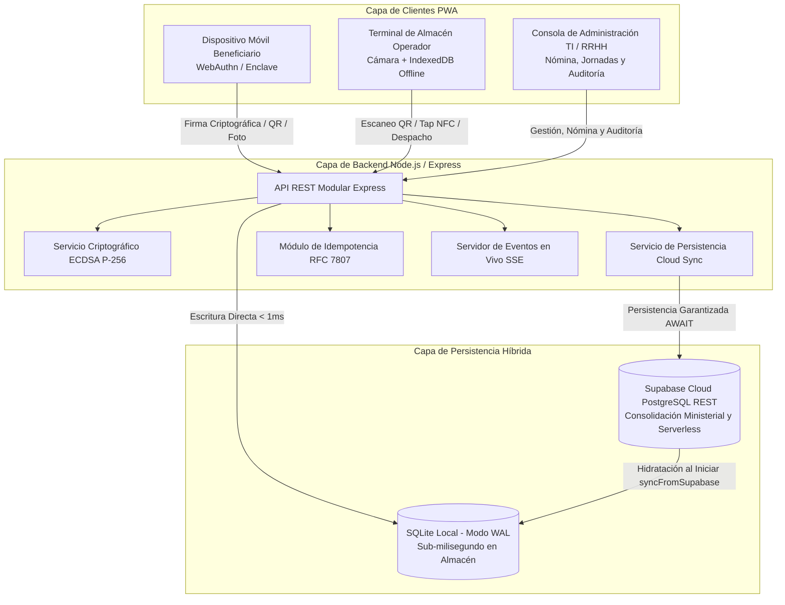

# Manual de Arquitectura y Recorridos de Usuario
## Sistema de Gestión de Beneficios a Trabajadores (SGBT) — MIPPCI

---

### 1. Vista de Arquitectura de Contenedores y Servicios

El sistema implementa una arquitectura híbrida desacoplada, diseñada para operar en entornos con conectividad inestable o nula, garantizando a la vez consolidación centralizada en la nube.

> **Diagrama Interactivo Autónomo:**  
> Puede interactuar con el modelo de contenedores, explorar tarjetas técnicas de infraestructura y alternar vistas en:  
> 👉 [c4-containers.html](file:///d:/Documents/Mippci/PROPUESTA%20DE%20PROYECTOS%20TI/Bolsa/docs/diagrams/c4-containers.html)

---

### 2. Recorridos de Usuario (*User Journeys*)

#### 2.1 Flujo del Beneficiario (Trabajador / Jubilado / Contratado)
1. **Acceso al Portal:** El funcionario ingresa a la aplicación web institucional desde su teléfono móvil o estación de trabajo indicando su Cédula de Identidad (ej. `V-18456123`).
2. **Formalización Inicial (Única vez si no está registrado):**
   - El sistema detecta su condición de formalización pendiente y abre el asistente de formalización.
   - **Fotografía de Perfil:** El usuario puede capturar su foto en vivo activando la cámara frontal (`capture="user"`) o adjuntar una fotografía nítida directamente desde la galería de imágenes de su teléfono.
   - **Contraseña Institucional y Dispositivo:** Establece su contraseña de acceso personal y vincula su dispositivo actual (`bound_device_id`).
   - El sistema persiste de inmediato estos datos en Supabase Cloud (`passkey_credentials`) de forma que al volver a ingresar o cerrar sesión, el beneficiario accede directamente sin que se le vuelva a requerir formalizarse.
3. **Registro de Biometría (Passkey FIDO2):**
   - El usuario puede enrolar su huella o rostro con la API `navigator.credentials.create` (FaceID, huella Android, Windows Hello).
   - La clave pública generada se almacena en `passkey_credentials` en la nube; la clave privada jamás abandona el dispositivo.
4. **Consulta de Jornada y Combos:**
   - La pantalla principal muestra las jornadas activas y los combos asignados (ej. Víveres Secos, Combo Proteico, Higiene, Limpieza).
5. **Generación de Comprobante de Retiro:**
   - Al pulsar "Generar Comprobante de Retiro", el sistema firma un reto criptográfico (`nonce`) mediante la Passkey.
   - Se despliega un código QR temporal dinámico con una cuenta regresiva de 180 segundos para evitar clonaciones.

#### 2.2 Flujo del Operador de Almacén (Punto de Despacho)
1. **Apertura de Estación:** El operador ingresa con su rol autorizado y selecciona el punto de distribución físico o mesa asignada.
2. **Lectura Óptica o Proximidad NFC:**
   - Apunta la cámara de la terminal al código QR del beneficiario.
   - En beneficiarios jubilados o sin teléfono móvil, aproxima la tarjeta física NFC del beneficiario para lectura por contacto (Tap-to-Claim P2P).
   - En caso de contingencia mayor, ingresa manualmente la Cédula de Identidad con comprobación visual.
3. **Verificación Automática:**
   - El sistema valida la firma criptográfica y comprueba la cuota pendiente en la jornada.
   - Si el beneficiario ya retiró, la pantalla emite un bloqueo en color rojo y alerta sonora disuasiva.
4. **Confirmación y Entrega:**
   - Si la asignación es válida, la pantalla se ilumina en verde, se emite una señal háptica de vibración corta y se registra la entrega de forma atómica.
   - La entrega se respalda de inmediato en Supabase Cloud con `await` y se descuenta el derecho en `daily_entitlements`.
   - Si se cae el enlace de red, el retiro se resguarda en IndexedDB para su sincronización diferida.

#### 2.3 Flujo del Administrador de Recursos Humanos y TI
1. **Acceso Administrativo Seguro:**
   - En la pantalla de login, presiona el botón **Acceso Administrativo**.
   - Ingresa su Cédula de Identidad o Correo Institucional (`Sfranco@mippci.gob.ve`) junto con la Clave / PIN de Seguridad de Gobernanza (`ADMIN_ACCESS_SECRET`).
   - El sistema valida el rol (`admin`), emite la cookie segura `HttpOnly` y concede acceso a la consola central.
2. **Configuración de Catálogo y Pesos:** Registro y activación de combos alimentarios, pesos oficiales en kilogramos, iconos y asignación de mesas en el almacén.
3. **Programación de Jornada:** Creación de la fecha de entrega, selección de los combos a despachar y generación masiva de cuotas.
4. **Carga de Nómina:** Ingesta de archivos Excel con el padrón actualizado de trabajadores, con validación de filas erróneas antes de aplicar.
5. **Auditoría DevSecOps y Monitoreo en Vivo:**
   - Supervisión de la curva de despacho en tiempo real mediante el canal de eventos en vivo (SSE).
   - Verificación de la consistencia de persistencia en la nube mediante `npm run verify:cloud`.
   - Emisión del Acta Digital Ministerial con sello criptográfico SHA-256.

> **Diagrama de Secuencia Interactivo:**  
> Para revisar el intercambio cronológico detallado de mensajes, firma y despacho en almacén:  
> 👉 [user-journey-sequence.html](file:///d:/Documents/Mippci/PROPUESTA%20DE%20PROYECTOS%20TI/Bolsa/docs/diagrams/user-journey-sequence.html)
