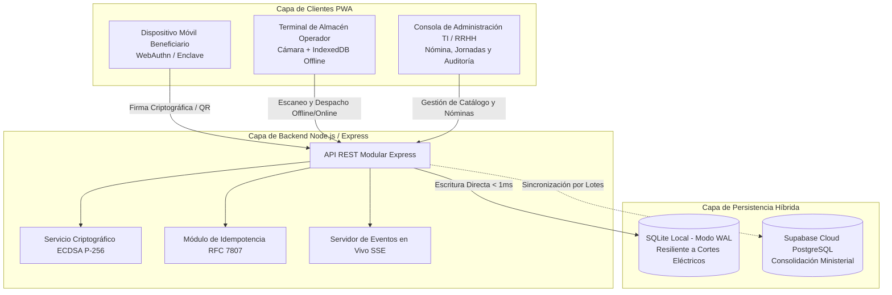

# Manual de Arquitectura y Recorridos de Usuario
## Sistema de Gestión de Beneficios a Trabajadores (SGBT) — MIPPCI

---

### 1. Vista de Arquitectura de Contenedores y Servicios

El sistema implementa una arquitectura híbrida desacoplada, diseñada para operar en entornos con conectividad inestable o nula, garantizando a la vez consolidación centralizada en la nube.

> **Diagrama Interactivo Autónomo:**  
> Puede interactuar con el modelo de contenedores, explorar tarjetas técnicas de infraestructura y alternar vistas en:  
> 👉 [c4-containers.html](file:///d:/Documents/Mippci/PROPUESTA%20DE%20PROYECTOS%20TI/Bolsa/docs/diagrams/c4-containers.html)

---

### 2. Recorridos de Usuario (*User Journeys*)

#### 2.1 Flujo del Beneficiario (Trabajador / Jubilado / Contratado)
1. **Acceso al Portal:** El funcionario ingresa a la aplicación web institucional desde su teléfono móvil o estación de trabajo.
2. **Registro de Biometría (Única vez):**
   - Pulsa "Registrar Credencial Biométrica".
   - El navegador invoca la API `navigator.credentials.create` delegando en el hardware del teléfono (FaceID, huella Android, Windows Hello).
   - La clave pública generada se almacena en el servidor; la clave privada jamás abandona el dispositivo.
3. **Consulta de Jornada y Combos:**
   - La pantalla principal muestra las jornadas activas y los combos asignados (ej. Víveres, Higiene, Limpieza y Charcutería).
4. **Generación de Comprobante de Retiro:**
   - Al pulsar "Generar Comprobante de Retiro", el sistema firma un reto criptográfico (`nonce`) mediante la Passkey.
   - Se despliega un código QR temporal dinámico con una cuenta regresiva de 180 segundos para evitar clonaciones.

#### 2.2 Flujo del Operador de Almacén (Punto de Despacho)
1. **Apertura de Estación:** El operador ingresa con su rol autorizado y selecciona el punto de distribución físico.
2. **Lectura Óptica:**
   - Apunta la cámara de la terminal al código QR del beneficiario.
   - En caso de contingencia o ausencia de teléfono, ingresa manualmente la Cédula de Identidad con comprobación visual.
3. **Verificación Automática:**
   - El sistema valida la firma criptográfica y comprueba la cuota pendiente en la jornada.
   - Si el beneficiario ya retiró, la pantalla emite un bloqueo en color rojo y alerta sonora disuasiva.
4. **Confirmación y Entrega:**
   - Si la asignación es válida, la pantalla se ilumina en verde, se emite una señal háptica de vibración corta y se registra la entrega de forma atómica.
   - Si se cae el enlace de red, el retiro se resguarda en IndexedDB para su sincronización diferida.

#### 2.3 Flujo del Administrador de Recursos Humanos y TI
1. **Configuración de Catálogo:** Registro y activación de combos alimentarios e higiene en el módulo institucional.
2. **Programación de Jornada:** Creación de la fecha de entrega, selección de los combos a despachar y generación masiva de cuotas.
3. **Carga de Nómina:** Ingesta de archivos Excel con el padrón actualizado de trabajadores, con validación de filas erróneas antes de aplicar.
4. **Monitoreo y Fiscalización:** Supervisión de la curva de despacho en tiempo real mediante el canal de eventos en vivo (SSE) y emisión del Acta Digital de Cierre.

> **Diagrama de Secuencia Interactivo:**  
> Para revisar el intercambio cronológico detallado de mensajes, firma y despacho en almacén:  
> 👉 [user-journey-sequence.html](file:///d:/Documents/Mippci/PROPUESTA%20DE%20PROYECTOS%20TI/Bolsa/docs/diagrams/user-journey-sequence.html)
