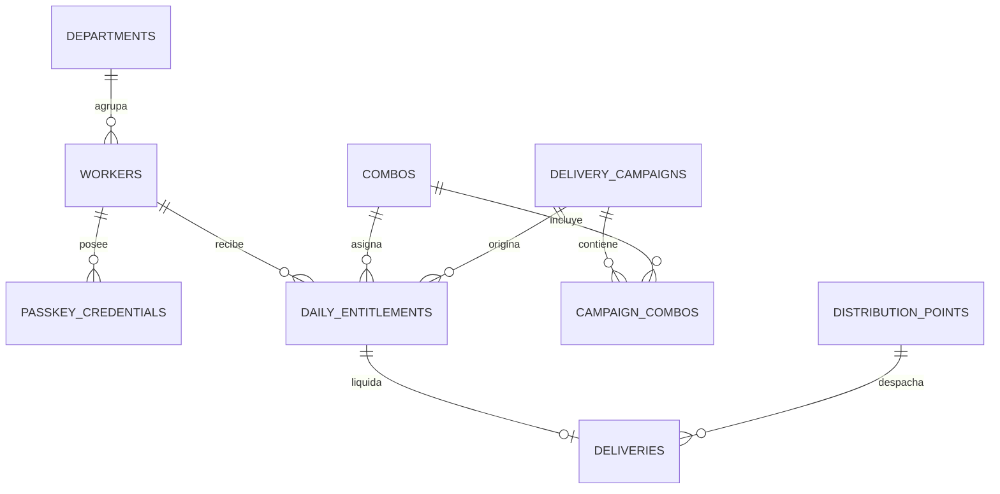

# Esquema de Base de Datos y Modelo Relacional
## Sistema de Gestión de Beneficios a Trabajadores (SGBT) — MIPPCI

---

### 1. Arquitectura Relacional y Dominios de Datos

La persistencia del sistema está modelada bajo tercera forma normal (3FN) con integridad referencial estricta, índices anti-fraude y disparadores atómicos (`triggers`). Se organiza en tres dominios funcionales:



> **Diagrama ERD Interactivo Autónomo:**  
> Visualice todas las entidades, columnas físicas, claves primarias y foráneas con soporte de zoom e inspección de tablas en:  
> 👉 [modelo-datos-erd.html](file:///d:/Documents/Mippci/PROPUESTA%20DE%20PROYECTOS%20TI/Bolsa/docs/diagrams/modelo-datos-erd.html)

---

### 2. Estructura de Tablas del Sistema

#### Dominio 1: Estructura Organizativa e Identidad
1. **`departments` (Direcciones y Entes):**
   - `id` (TEXT, PK): Identificador UUID.
   - `code` (TEXT, UNIQUE): Código institucional (ej. `DGTIC`, `RRHH`, `VTV`).
   - `name` (TEXT): Denominación de la dirección general u organismo.
   - `cost_center` (TEXT): Centro de costos contable.

2. **`workers` (Padrón de Trabajadores y Personal Operativo):**
   - `id` (TEXT, PK): Identificador UUID.
   - `document_id` (TEXT, UNIQUE): Número de Cédula de Identidad con prefijo (`V-12345678`).
   - `full_name` (TEXT): Nombres y apellidos completos.
   - `email` (TEXT, UNIQUE): Correo institucional.
   - `department_id` (TEXT, FK): Enlace a `departments(id)`.
   - `shift` (TEXT): Turno de trabajo (`mañana`, `tarde`, `jornada_continua`).
   - `status` (TEXT): Condición laboral (`active`, `suspended`, `terminated`).
   - `worker_type` (TEXT): Clasificación (`activo`, `jubilado`, `pensionado`, `contratado`).
   - `role` (TEXT): Nivel de autorización (`worker`, `operator`, `supervisor`, `admin`).
   - `has_smartphone` (INTEGER): Bandera binaria (1 = teléfono inteligente propio, 0 = contingencia).
   - `photo_url` (TEXT): Fotografía del funcionario (captura de cámara frontal o galería).
   - `enrollment_status` (TEXT): Estado de formalización (`pendiente`, `registrado`).
   - `password_hash` (TEXT): Hash criptográfico seguro de la contraseña institucional.
   - `bound_device_id` (TEXT): Identificador único de hardware del dispositivo móvil vinculado.
   - `enrolled_at` (TEXT): Estampa de tiempo de culminación de formalización.

3. **`passkey_credentials` (Credenciales Criptográficas y Formalización en la Nube):**
   - `id` (TEXT, PK): UUID interno.
   - `worker_id` (TEXT, FK): Vínculo al trabajador en `workers(id)`.
   - `credential_id` (TEXT, UNIQUE): Identificador de la credencial. Para Passkeys WebAuthn es el ID en Base64URL; para formalizaciones es `formalized_pwd_{worker_id}`.
   - `public_key` (TEXT): Clave pública ECDSA P-256 en formato PEM, o hash de contraseña para credenciales de formalización.
   - `sign_count` (INTEGER): Contador de firmas anti-clonación.
   - `device_name` (TEXT): Modelo de hardware registrado o identificador de dispositivo.
   - `aaguid` (TEXT): Identificador de atestación de autenticador (`beneficiary_formalization` para credenciales de contraseña).
   - `status` (TEXT): Condición de la credencial (`active`, `revoked`).

4. **`nfc_cards` (Tarjetas Físicas de Proximidad NFC / RFID):**
   - `id` (TEXT, PK): UUID interno.
   - `worker_id` (TEXT, FK): Beneficiario asignado.
   - `card_uid` (TEXT, UNIQUE): Identificador único de fábrica del chip NFC (ej. `04A1B2C3D4E5F6`).
   - `status` (TEXT): `active`, `revoked`, `lost`.
   - `issued_by` (TEXT, FK): Operador o supervisor que emitió el plástico.
   - `issued_at` (TEXT): Fecha y hora de vinculación.

#### Dominio 2: Beneficios, Jornadas y Cuotas
5. **`combos` (Catálogo de Beneficios):**
   - `id` (TEXT, PK): Identificador UUID.
   - `name` (TEXT): Nombre descriptivo (ej. Víveres, Higiene, Limpieza, Charcutería).
   - `description` (TEXT): Contenido detallado del beneficio.
   - `category` (TEXT): Clasificación nutricional o de insumo.
   - `is_active` (INTEGER): Estado en catálogo (1 = activo, 0 = inactivo).

5. **`delivery_campaigns` (Jornadas Institucionales):**
   - `id` (TEXT, PK): Identificador UUID.
   - `name` (TEXT): Título de la jornada (ej. `Jornada Especial Octubre 2026`).
   - `description` (TEXT): Justificación administrativa.
   - `start_date` (TEXT) y `end_date` (TEXT): Fechas de vigencia de retiro.
   - `target_group` (TEXT): Alcance poblacional (`all`, departamentos específicos o tipos de nómina).
   - `status` (TEXT): Estado del operativo (`programada`, `en_curso`, `finalizada`, `cancelada`).

6. **`campaign_combos` (Asociación Multi-Combo por Jornada):**
   - Clave compuesta: `(campaign_id, combo_id)`. Vincula múltiples combos alimenticios a una misma fecha de distribución.

7. **`daily_entitlements` (Cuotas y Derechos de Retiro):**
   - `id` (TEXT, PK): Identificador UUID.
   - `worker_id` (TEXT, FK): Beneficiario asignado.
   - `combo_id` (TEXT, FK): Combo específico que le corresponde.
   - `valid_date` (TEXT): Fecha límite de validez.
   - `campaign_id` (TEXT, FK): Jornada de origen.
   - `status` (TEXT): `pending`, `claimed`, `expired`.
   - **Restricción de unicidad:** `UNIQUE (worker_id, valid_date, combo_id)` para garantizar exactamente una asignación por tipo de combo por jornada.

#### Dominio 3: Despacho, Idempotencia y Auditoría
8. **`deliveries` (Registro Transaccional de Entregas Físicas):**
   - `id` (TEXT, PK): Identificador UUID del evento.
   - `entitlement_id` (TEXT, FK): Cuota consumida en `daily_entitlements(id)`.
   - `worker_id` (TEXT, FK): Beneficiario que retiró.
   - `distribution_point_id` (TEXT, FK): Almacén donde se ejecutó el despacho.
   - `delivered_by_user_id` (TEXT, FK): Operador de estación responsable.
   - `verification_method` (TEXT): `passkey_qr`, `nfc_card`, `supervisor_override`.
   - `signature_proof` (TEXT): Firma criptográfica verificada.
   - `challenge_nonce` (TEXT): Reto de un solo uso que previene repetición.
   - `delivered_at` (TEXT): Estampa de tiempo certificada.

---

### 3. Índices Críticos y Disparadores Anti-Fraude

1. **Prevención Estricta de Doble Reclamo:**
   ```sql
   CREATE UNIQUE INDEX IF NOT EXISTS idx_unique_daily_claim 
   ON deliveries (worker_id, entitlement_id);
   ```
   Si una terminal intenta registrar dos veces la misma entrega (por reintento de red o fraude), el motor de base de datos rechaza la transacción de forma inmediata.

2. **Disparador Atómico de Consumo:**
   ```sql
   CREATE TRIGGER IF NOT EXISTS trg_mark_entitlement_claimed
   AFTER INSERT ON deliveries
   BEGIN
     UPDATE daily_entitlements
     SET status = 'claimed'
     WHERE id = NEW.entitlement_id;
   END;
   ```
   Garantiza que la asignación pase a estado `claimed` en la misma transacción donde se asienta la entrega.

---

### 4. Estrategia de Persistencia y Reconciliación con Supabase Cloud

Para armonizar la persistencia entre el motor SQLite local y la base de datos PostgreSQL en Supabase Cloud bajo entornos serverless (Vercel):

1. **Gestión de Llaves Foráneas en `deliveries`:**  
   Supabase Cloud exige `NOT NULL` en `entitlement_id` y `distribution_point_id`. El servicio [`cloud_sync.service.js`](../../backend/services/cloud_sync.service.js) efectúa un upsert preventivo de la cuota en `daily_entitlements` si no existiese y asigna la sede central (`ALM-MIPPCI`, UUID `5b0f10e3-7eac-4872-bf96-74ecd359be7e`) en entregas sin punto explícito.
2. **Reconciliación Idempotente en SQLite (`syncFromSupabase`):**  
   Al instanciarse un contenedor en Vercel, la hidratación aplica:
   - `ON CONFLICT(credential_id) DO UPDATE SET...` en `passkey_credentials`.
   - `ON CONFLICT(card_uid) DO UPDATE SET...` en `nfc_cards`.
   - Marca atómica de cuotas consumidas en `daily_entitlements` si figuran en `deliveries`.
   - Reincorporación del estado `enrollment_status = 'registrado'` y hash de contraseña para trabajadores formalizados.
