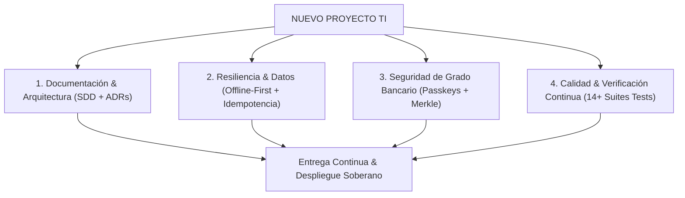
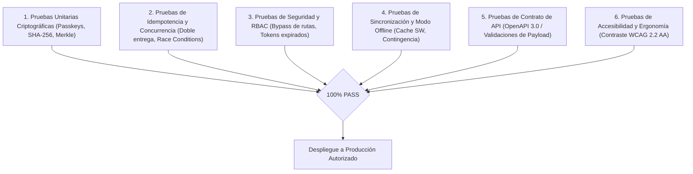

# Guía Maestra de Desarrollo e Ingeniería de Software para Proyectos TI Institucionales

> **Marco de Referencia Técnico para el Desarrollo de Software Soberano, Resiliente y de Alto Rendimiento**  
> *Dirección General de Tecnologías de la Información y la Comunicación — MIPPCI y Entes Adscritos*

---

## 1. Propósito y Filosofía Rectora

Esta guía condensa y sistematiza las lecciones aprendidas, patrones arquitectónicos y estándares de ingeniería aplicados con éxito en los proyectos institucionales de mayor criticidad y rendimiento (**SGBT / Bolsa de Beneficios** y **TI-Atlas 3D**). 

Su propósito es servir como **estándar de inicio y desarrollo** para cualquier nuevo sistema de información, plataforma web o aplicativo móvil dentro de la institución, asegurando que desde el día uno se cumplan garantías de **soberanía tecnológica, seguridad criptográfica, tolerancia a fallos y alta calidad de código**.



---

## 2. Los 7 Principios Fundamentales de Desarrollo

### Principio I: Offline-First y Resiliencia en Red (Local-First Design)
* **La premisa de oro:** Asumir que la conectividad es inestable, saturada o intermitente. El usuario debe poder trabajar sin conexión.
* **Persistencia local primaria:** 
  - En terminales móviles / navegadores: Utilizar **PWA con Service Workers** (`CacheFirst` para activos estáticos y `NetworkFirst` con fallback local para datos) y **IndexedDB** para almacenamiento de estado cliente.
  - En servidores / backend: Emplear bases de datos embebidas ultrarrápidas como **SQLite con `better-sqlite3`**, sincronizadas asíncronamente con la base de datos de producción o en nube (PostgreSQL / Supabase).
* **Idempotencia matemática:** Todas las transacciones de modificación deben contar con claves de idempotencia o índices únicos (`UNIQUE INDEX`, ej. `idx_unique_daily_claim`) para que una sincronización repetida nunca genere registros duplicados.

### Principio II: Seguridad Criptográfica y Cero Confianza (Zero-Trust)
* **Eliminación de contraseñas vulnerables:** Implementar autenticación asimétrica **WebAuthn / Passkeys (FIDO2)** con algoritmo P-256 (ES256). Las claves privadas jamás salen del chip de seguridad biométrico del usuario.
* **Tokens y credenciales rotativas:** Códigos QR firmados con rotación diaria o de corta expiración para procesos de supervisión o canje físico.
* **Trazabilidad matemática anti-repudio:** Emplear árboles de Merkle (**Merkle Trees RFC 6962**) y sellos de integridad SHA-256 en reportes, actas y recepciones de entrega. Esto convierte cualquier intento de manipulación en una contradicción matemática detectable.
* **Segregación estricta de privilegios (RBAC):** Separar por completo los alcances (*scopes*). Un token de beneficiario jamás debe poder consultar endpoints administrativos, validado tanto en middleware backend como en interfaz.

### Principio III: Separación de Responsabilidades y Escalabilidad (CQRS & Caching)
* **Segregación CQRS (Read/Write Split):**
  - Las transacciones críticas de escritura van al nodo primario transaccional bajo garantías ACID.
  - Las lecturas masivas, consultas de tablas y reportes van dirigidas a réplicas o cachés optimizados.
* **Patrón Cache-Aside transparente:**
  - Caché en memoria para configuraciones de marca (`tenant_settings`), estadísticas e índices de búsqueda con TTL estricto.
  - Invalidación selectiva por patrones (*wildcards*) en cada mutación de datos.
* **Colas de tareas en segundo plano con Backoff Exponencial:**
  - Operaciones pesadas (envío de notificaciones Web Push VAPID, generación de sellos criptográficos, ingestión masiva de nóminas) deben encolarse para no bloquear la respuesta HTTP al usuario.

### Principio IV: Diseño Intencional, Separación de Roles y Accesibilidad
* **Separación de interfaces por perfil:** Evitar interfaces "monolíticas" donde un usuario ve botones que no le corresponden.
  - Interfaz de Beneficiario: Minimalista, legible, enfocada en carnet digital y estado de beneficio.
  - Interfaz de Supervisor/Mesa: Optimizada para lectura rápida con escáner QR, alta velocidad de procesamiento y confirmación sonora/háptica.
  - Interfaz Directiva/Admin: Filtros avanzados, paginación configurable, gráficos ejecutivos y exportación forense (PDF/Excel).
* **Accesibilidad y ergonomía visual (WCAG 2.2 AA):**
  - Soporte nativo y sin parpadeo de Modo Claro y Modo Oscuro.
  - Contraste de color superior a 4.5:1 en textos e interactivos.
  - Tamaños de toque mínimos (44×44 px) y navegación completa por teclado.

### Principio V: Documentación Conducida por Especificación (Spec-Driven Development)
* **Si no está documentado, no existe:** La base de cualquier desarrollo exitoso (especialmente al trabajar asistido por Agentes de Inteligencia Artificial) es la existencia de especificaciones rigurosas y desacopladas. Antes de generar una sola línea de código, el proyecto debe contar con su corpus documental completo.
* **Componentes obligatorios de la especificación:**
  - **Requisitos Funcionales (Historias de Usuario):** Definidas con narrativa clara (*"Como [rol] quiero [acción] para [beneficio]"*) y criterios de aceptación verificables bajo el estándar *Given-When-Then* (Dado-Cuando-Entonces).
  - **Requisitos No Funcionales (RNF):** Metas explícitas de rendimiento (ej. latencia p95 < 50ms), disponibilidad sin red (Offline-First), criptografía asimétrica, presupuestos de memoria y tamaño de bundle.
  - **Interfaces y Casos Límite (Edge Cases):** Definición rigurosa de qué ocurre ante pérdida de conexión, tokens expirados, colisiones de concurrencia, datos incompletos o maliciosos, límites de carga y estados vacíos (*empty states*).

#### Inventario Documental Estándar y su Función Frente al Agente de IA:

| Documento | Archivo sugerido | Función frente al agente de IA |
| :--- | :--- | :--- |
| **Requisitos del Producto (PRD)** | `PRD.md` o `01_PRD.md` | Explica la visión de negocio, el flujo general y el valor para el usuario antes de bajar al detalle técnico. Evita que la IA implemente funcionalidades innecesarias o desalineadas del objetivo institucional. |
| **Especificación de Requisitos (SRS)** | `01_ESPECIFICACION_REQUISITOS_SRS.md` | Define las historias de usuario detalladas, requisitos no funcionales, reglas de negocio y criterios de aceptación (*Given-When-Then*). |
| **Arquitectura y Tech Stack (TRD)** | `ARQUITECTURA_TRD.md` o `02_ARQUITECTURA...` | Fija los lenguajes, frameworks, librerías admitidas, base de datos y estructura de carpetas para que la IA no improvise ni adivine tecnologías ajenas al estándar institucional. |
| **Flujo de Usuario y Pantallas** | `FLUJO_APLICACION.md` | Describe la navegación paso a paso, rutas, transiciones y los estados posibles de cada vista o componente (carga, vacío, error, éxito). |
| **Diseño UI/UX y Frontend** | `DISENO_UI_UX.md` | Define la paleta de colores, tipografías, jerarquías visuales, reglas de responsividad, espaciados y directrices de accesibilidad (WCAG 2.2 AA). |
| **Seguridad y Accesos** | `SEGURIDAD_ACCESOS.md` o `05_GUIA_SEGURIDAD...` | Establece roles (RBAC), matriz de permisos, métodos de autenticación (Passkeys/JWT) y políticas de protección y sanitización de datos. |
| **Modelo y Base de Datos** | `03_ESQUEMA_BASE_DATOS_Y_MODELO.md` | Define las tablas, tipos de datos, índices únicos, claves foráneas y restricciones de integridad matemática. |
| **Reglas del Agente / Contexto** | `GEMINI.md` / `CLAUDE.md` / `.cursorrules` | Contiene instrucciones permanentes, convenciones de código, comandos de prueba obligatorios (`npm test`, `node -c`) y el flujo estricto de consultar la especificación antes de programar. |
| **Lista de Tareas / Backlog** | `TAREAS_IMPLEMENTACION.md` | Desglosa la especificación en tickets pequeños, atómicos y secuenciales para que el agente ejecute y verifique una funcionalidad a la vez con pruebas inmediatas. |
| **Registro de Decisiones (ADR)** | `docs/adr/ADR-XXXX.md` | Bitácora inmutable que justifica cada elección arquitectónica relevante (contexto, alternativas evaluadas y consecuencias). |

### Principio VI: Búsqueda y Navegación Instantánea Client-Side
* Para catálogos, directores o enciclopedias (como en TI-Atlas 3D), preferir **indexación en memoria en el cliente** (`Ctrl+K Pinpointer`) con coincidencia por prefijo y palabras clave curadas.
* Reduce a cero la latencia de búsqueda y no satura la base de datos con peticiones `LIKE %...%` innecesarias.

### Principio VII: Puertas de Calidad Automatizadas y CI/CD Obligatorio
* **Pre-commit estricto:**
  1. Verificación de sintaxis de cada archivo JS/TS modificado (`node -c <archivo>`).
  2. Ejecución completa de suites de pruebas (`npm test`) con 100% de éxito requerido.
* **Commits semánticos convencionales:** Formato estricto (`feat:`, `fix:`, `docs:`, `refactor:`, `test:`).
* **Despliegue continuo automatizado:** El push a la rama principal (`main`) debe desencadenar automáticamente el build y despliegue a la plataforma de producción (Edge / Vercel / VPS).

---

## 3. Estructura de Proyecto Canónica Recomendada

Cualquier proyecto nuevo debe organizar su árbol de archivos siguiendo esta estructura probada:

```text
mi-proyecto-ti/
├── backend/                        # API RESTful, Controladores y Lógica de Negocio
│   ├── controllers/                # Controladores delgados por dominio
│   ├── middleware/                 # Autenticación, RBAC, límites de tasa y validación
│   ├── routes/                     # Rutas RESTful declarativas (/api/v1/...)
│   ├── services/                   # Lógica pura: criptografía, colas, caché, sync
│   ├── db.js (o db.ts)             # Conexión, migraciones automáticas y seeds
│   └── server.js                   # Arranque Express, CORS y cabeceras de seguridad
│
├── public/ (o src/)                # Frontend: Vistas, Componentes y Activos
│   ├── css/                        # Variables CSS semánticas, modo oscuro/claro
│   ├── js/                         # Vanilla modular o TS
│   │   ├── modules/                # Componentes desacoplados (auth, share, qr, ui)
│   │   └── app.js                  # Inicialización y enrutamiento cliente
│   ├── templates/                  # Modales y componentes externos cargados dinámicamente
│   ├── sw.js                       # Service Worker PWA (Offline-First)
│   └── index.html                  # Shell HTML accesible y semántico
│
├── docs/                           # Ciclo de Vida Documental Obligatorio
│   ├── PRD.md                      # Visión de Negocio y Requisitos del Producto
│   ├── 01_ESPECIFICACION_REQUISITOS_SRS.md # Historias de usuario, RNF y casos límite
│   ├── ARQUITECTURA_TRD.md         # Arquitectura técnica y Tech Stack fijado
│   ├── FLUJO_APLICACION.md         # Navegación paso a paso, rutas y pantallas
│   ├── DISENO_UI_UX.md             # Sistema de diseño, paleta, tipografía y accesibilidad
│   ├── SEGURIDAD_ACCESOS.md        # Matriz RBAC, autenticación y protección de datos
│   ├── TAREAS_IMPLEMENTACION.md    # Backlog secuencial y atómico para Agentes IA
│   ├── 03_ESQUEMA_BASE_DATOS_Y_MODELO.md # Tablas, restricciones e índices únicos
│   ├── 04_DICCIONARIO_DE_DATOS.md  # Catálogo exhaustivo de entidades y campos
│   └── adr/                        # Registro de Decisiones de Arquitectura (ADR-0001...)
│
├── tests/                          # Suites de Pruebas Automatizadas
│   ├── unit/                       # Pruebas de funciones puras y servicios
│   ├── integration/                # Pruebas de endpoints REST y base de datos
│   ├── e2e/                        # Flujos completos (login, despacho, offline)
│   └── security/                   # Hardening, RBAC bypass y contratos de API
│
├── scripts/                        # Automatizaciones de mantenimiento, backups y seeds
├── package.json                    # Dependencias estrictamente acotadas
├── GEMINI.md / AGENTS.md           # Reglas de desarrollo y guardrails de IA
└── README.md                       # Manual de instalación y ejecución local
```

---

## 4. Stack Tecnológico Sugerido por Dominio

| Capa | Tecnologías Recomendadas | Criterio de Selección |
| :--- | :--- | :--- |
| **Frontend Web** | HTML5 semántico + Vanilla JS Modular o React/TypeScript + Tailwind/CSS variables | Carga ultrarrápida, sin dependencias pesadas, facilidad de mantenimiento a largo plazo. |
| **Persistencia Local** | SQLite con `better-sqlite3` (Server) / IndexedDB (Client) | Rendimiento nativo C++, sin necesidad de servidor de BD externo para operar offline. |
| **Persistencia Cloud** | PostgreSQL / Supabase REST API | Robustez relacional, interoperabilidad REST, soporte de Row Level Security (RLS). |
| **Seguridad / Criptografía** | WebAuthn / SimpleWebAuthn (FIDO2) + Node `crypto` nativo | Estándar bancario P-256, sin contraseñas en texto plano, sellos SHA-256. |
| **Caché & Colas** | Cache-Aside en memoria con TTL + Worker de eventos asíncronos | Cero dependencias adicionales en despliegues pequeños con capacidad de escalar a Redis. |
| **Testing** | Node test runner nativo o Jest / Supertest | Pruebas rápidas, sin configuración engorrosa, integrables directamente a CI/CD. |
| **Despliegue** | PWA + Vercel Edge / VPS Linux Dockerizado | Despliegues continuos, certificados TLS automáticos y CDN perimetral. |

---

## 5. Matriz de Pruebas Automatizadas Obligatorias

Todo proyecto que aspire a producción debe cubrir las siguientes suites de verificación:



---

## 6. Checklist de Arranque para Nuevos Proyectos (Día 1)

Al iniciar un nuevo proyecto tecnológico en el ministerio o entes adscritos, completar este checklist antes de escribir la primera línea de negocio:

- [ ] **1. Repositorio & Reglas:** Crear el repositorio con `.gitignore` estricto y archivo `AGENTS.md` o `GEMINI.md` estableciendo las políticas de calidad y push.
- [ ] **2. Carpeta `docs/`:** Inicializar el SRS (`01_SRS.md`) y el modelo relacional previsto antes de codificar la persistencia.
- [ ] **3. Esquema de BD con Idempotencia:** Definir tablas con claves foráneas estrictas, `updated_at`, campos de auditoría (`created_by`, `audit_hash`) e índices únicos contra duplicaciones.
- [ ] **4. Autenticación Asimétrica:** Implementar desde el inicio soporte WebAuthn/Passkeys o tokens firmados con caducidad; evitar sistemas obsoletos de contraseñas débiles.
- [ ] **5. Arquitectura de Modo Offline:** Configurar Service Worker básico y soporte de almacenamiento local desde el primer sprint.
- [ ] **6. Suite de Pruebas Inicial:** Dejar configurado el comando `npm test` con al menos una prueba E2E de inicio de sesión y salud del servidor (`/health` o `/status`).
- [ ] **7. Pipeline CI/CD:** Vincular el repositorio a la plataforma de despliegue continuo para que cada cambio validado se publique de forma automática.
