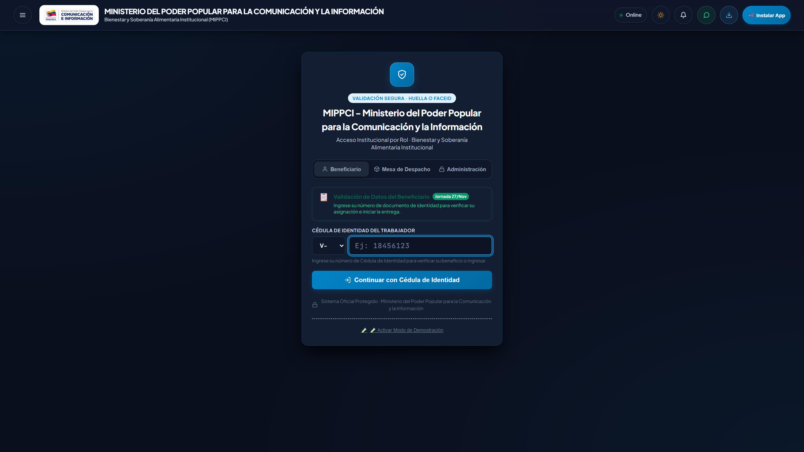
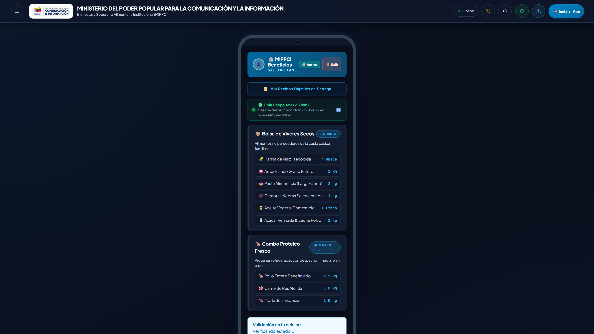
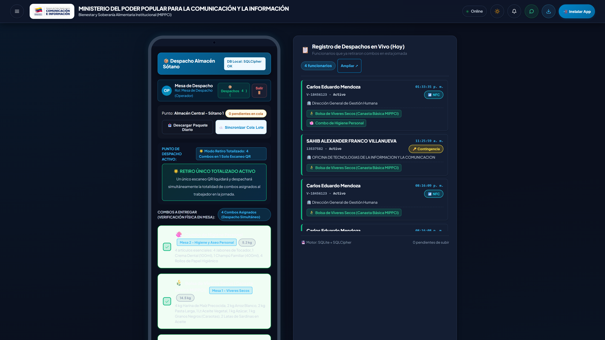
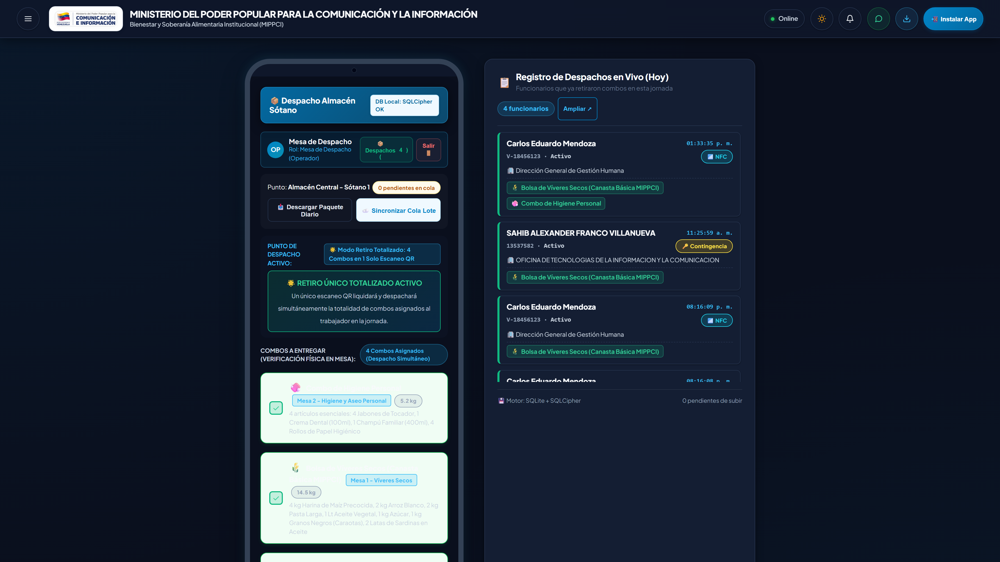
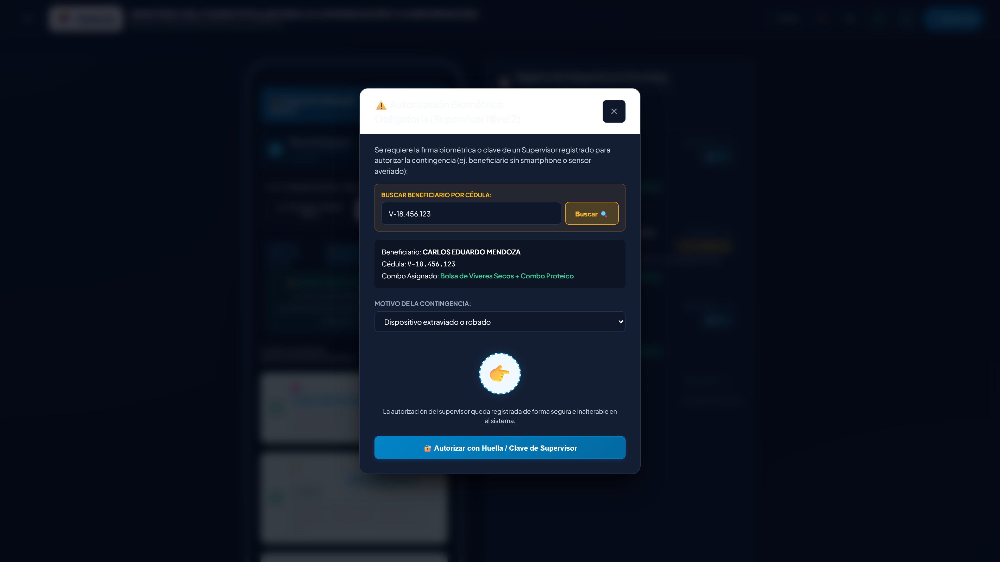

# Proceso Operativo y Tecnológico de Entrega de Combos Alimenticios — SGBT (MIPPCI)

El **Sistema de Gestión de Beneficios a Trabajadores (SGBT)** del **Ministerio del Poder Popular para la Comunicación y la Información (MIPPCI)** es una plataforma de grado bancario diseñada bajo la filosofía **Offline-First**, gobernanza de datos estricta e **idempotencia matemática**. Su objetivo primordial es garantizar que cada funcionaria y funcionario de la institución reciba su cuota mensual de beneficios alimenticios de manera digna, rápida, transparente y sin posibilidad de duplicidades, desvíos ni trabas burocráticas.

Este documento desglosa en profundidad cada una de las fases del proceso de despacho, especificando el flujo funcional, las pantallas de usuario reales involucradas, sus componentes interactivos y los mecanismos de seguridad criptográfica subyacentes.

---

## 🗺️ Mapa de Pantallas del Ecosistema SGBT

| Código de Pantalla | Nombre Operativo | Rol Principal | Captura del Sistema |
| :--- | :--- | :--- | :--- |
| **`view-login`** | Portal de Acceso Universal | Todos |  |
| **`view-worker`** | Carnet Digital del Beneficiario | Beneficiario |  |
| **`view-distributor`** | Consola de Mesa de Despacho | Operador / Almacén |  |
| **`modal-scanner`** | Lector Óptico y HUD Sub-segundo | Operador / Almacén |  |
| **`modal-supervisor`** | Módulo de Contingencia Asistida | Supervisor de Almacén |  |
| **`modal-receipts`** | Historial de Recibos Digitales | Beneficiario / Auditor |  |
| **`view-admin`** | Tablero Central de Auditoría Ministerial | Dirección General / RRHH |  |

---

## 🏛️ Fase 1: Apertura de Jornada y Preparación del Almacén

Antes del inicio de la atención al personal, el equipo de almacén y logística habilita los puntos de despacho físicos (Almacén Central Sótano 1, Comedor Ministerial o Sedes Adscritas).

### 🖥️ Pantallas Involucradas:
1. **Pantalla de Acceso Institucional (`#view-login`):**
   - **Campos e Interacción:** El operador ingresa su Cédula de Identidad o Correo Oficial (`document_id`).
   - **Mecanismos de Autenticación:** 
     - *Passkeys FIDO2 / WebAuthn:* Inicio de sesión instantáneo con biometría (huella dactilar o reconocimiento facial) en tablet o teléfono oficial.
     - *PIN Administrativo:* Para estaciones de escritorio fijas, se solicita el PIN de seguridad de operador (`admin_secret`).
   - **Selector de Sede Física:** Selección del punto logístico activo (`#pickupPointSelect`), asignando la mesa al inventario correspondiente.
   - **Blindaje de Seguridad:** Protección contra ataques de fuerza bruta (`checkAccountLockout`) y campo trampa anti-bots (*Honeypot*).


*Figura 1: Portal de Acceso Universal con selección de roles (Beneficiario, Operador de Almacén y Control de Administración).*

2. **Consola del Distribuidor (`#view-distributor` - Cabecera Operativa):**
   - **Identidad del Operador (`#distributorOperatorIdentityBar`):** Muestra el nombre, avatar y rol del despachador responsable.
   - **Badge de Almacenamiento Local (`#distributorModeBadge`):** Confirma que el motor de base de datos local SQLite / SQLCipher está inicializado y cifrado.
   - **Descarga del Paquete Diario Criptográfico (*Daily Pack* - `#btnDownloadDailyPack`):**
     - Al presionar este botón al iniciar la mañana, el sistema descarga el padrón completo de trabajadores activos y las cuotas de combos asignadas para la fecha.
     - El paquete queda sellado localmente en IndexedDB. Si el almacén pierde conectividad eléctrica o de Internet, **la jornada no se detiene y opera al 100% de manera autónoma**.


*Figura 2: Consola de Mesa de Despacho con estado de base de datos local SQLCipher, control de cola diferida y standby de cámara.*

---

## 📲 Fase 2: Presentación del Beneficiario y Carnet Móvil

El funcionario acude al punto de entrega y visualiza en su dispositivo móvil su credencial digital institucional.

### 🖥️ Pantalla del Carnet Oficial del Trabajador (`#view-worker`):
- **App Bar Ministerial (`.mobile-app-bar`):**
  - Fotografía oficial y avatar con iniciales (`#workerHeaderAvatar`).
  - Nombre completo, número de Cédula y adscripción departamental (`#workerHeaderIdentity`).
  - Insignia de Condición Laboral (`#workerConditionBadge`): *Personal Directivo, Empleado Fijo, Contratado, Jubilado o Comisión de Servicio*.
- **Semáforo de Afluencia de Colas en Tiempo Real (`#queueTrafficContainer`):**
  - Informa al trabajador el estado del flujo en el comedor o sótano:
    - 🟢 *Verde:* Cola despejada (tiempo de espera estimado < 3 minutos).
    - 🟡 *Ámbar:* Flujo moderado (5 a 10 minutos).
    - 🔴 *Rojo:* Afluencia alta (se sugiere aguardar el aviso por departamento).
- **Desglose de Combos Asignados (`#workerPackagesSection`):**
  - **Bulto 1 (Víveres Secos - Canasta Básica MIPPCI):** 12 rubros esenciales (Harina de maíz precocida, arroz blanco, pasta alimenticia, caraotas negras, aceite vegetal, azúcar refinada y leche en polvo).
  - **Bulto 2 (Combo Proteico Fresco):** Cadena de frío garantizada (Pollo entero beneficiado ~2.2 kg, carne de res molida 1 kg, mortadela especial 1 kg).
- **Candado de Dispositivo Activo (`#deviceLockBadgeContainer`):**
  - Genera una clave de hardware (`KEY-A7F9-MIPPCI`) vinculada al teléfono del trabajador, impidiendo que capturas de pantalla sean enviadas a terceros para retirar combos fraudulentamente.
- **Código QR Criptográfico Dinámico (`#workerQrContainer`):**
  - **Rotación Criptográfica:** El código QR incorpora un *Nonce* de un solo uso y firma HMAC SHA-256 que se renueva cada 60 segundos.
  - **Barra de Cuenta Regresiva (`#qrCountdownFill`):** Indicador visual que muestra el tiempo restante antes de la regeneración del token.
  - **Botón Brillo 100% (`#btnToggleBrightness`):** Eleva al máximo el brillo de la pantalla del smartphone para facilitar la lectura óptica bajo iluminación de sótano.
- **Validación por Proximidad NFC Móvil (`#workerNfcTouchPanel`):**
  - Para teléfonos con chip NFC, el beneficiario puede presionar *Tocar con NFC* y acercar su dispositivo a la tablet del operador (validación *Tap-to-Claim P2P* sin encender cámara).


*Figura 3: Carnet Móvil Institucional con App Bar oficial, semáforo de colas, cuota de bultos, candado de hardware y QR dinámico.*

---

## 🔍 Fase 3: Escaneo, Verificación Óptica e Idempotencia

En la taquilla de entrega, el operador captura la credencial del beneficiario.

### 🖥️ Pantallas Involucradas:
1. **Mesa de Despacho (`#view-distributor` - Módulo de Escáner):**
   - **Lector de Código QR en Vivo (`#liveCameraContainer`):**
     - El operador inicia el escáner (`#btnStartCameraScanner`) que activa la cámara con selección de lente frontal/trasera (`#btnFlipCameraLive`).
     - Compatible con pistolas lectoras láser USB / Bluetooth que ingresan el token en milisegundos sin latencia.
   - **HUD de Detección Sub-segundo (`#cameraScanHUD`):**
     - En menos de 120 ms, la interfaz proyecta una superposición de confirmación en verde con el nombre del funcionario y su cuota autorizada.
   - **Ficha de Verificación de Identidad:**
     - Proyecta la fotografía oficial de la ficha de personal, cédula y departamento para verificación visual del operador contra la persona en ventanilla.


*Figura 4: Visor de escaneo óptico en vivo con HUD verde de confirmación instantánea de identidad y combos asignados.*

2. **El Escudo Matemático de Idempotencia (`idx_unique_daily_claim`):**
   - Antes de habilitar cualquier entrega, el motor relacional ejecuta una consulta con bloqueo exclusivo:
     ```sql
     SELECT id FROM deliveries 
     WHERE worker_id = ? AND delivery_date = CURRENT_DATE 
     LIMIT 1;
     ```
   - **Resultado A (Habilitado):** El botón de despacho se activa en verde esmeralda brillante.
   - **Resultado B (Intento de Duplicidad):**
     - Si el trabajador intenta retirar dos veces el mismo día (por ejemplo, en mesas distintas), la pantalla del operador despliega un **Overlay Rojo de Alerta Crítica (`#distributorFeedbackOverlay`)**:
       - `❌ ENTREGA DENEGADA: BENEFICIO YA RETIRADO HOY`
       - Muestra fecha, hora exacta (ej. `10:14:22 a. m.`) y nombre del operador que procesó la entrega previa.
       - La base de datos rechaza la transacción a nivel de restricción `UNIQUE`, haciendo matemáticamente imposible la duplicidad.

---

## 🤝 Fase 4: Despacho Asistido y Contingencias Especiales

El SGBT contempla casos excepcionales para garantizar que ningún trabajador quede desatendido por fallas tecnológicas personales.

### 🖥️ Pantallas Involucradas:
1. **Modal de Contingencia Asistida (`#supervisorModalBackdrop`):**
   - **Activación:** Se invoca cuando un trabajador no posee smartphone, presenta la pantalla dañada o agotó su batería.
   - **Búsqueda por Cédula:** El supervisor ingresa el documento (`#supervisorContingencyDocInput`) y el sistema extrae su registro del padrón local.
   - **Justificación Obligatoria Auditada (`#modalOverrideReasonSelect`):**
     - El supervisor debe tipificar el motivo: *Sin teléfono inteligente, teléfono descargado/averiado, adulto mayor con asistencia o caso médico*.
   - **Autorización de Supervisor:** La entrega requiere el PIN o escaneo del código QR diario del supervisor (`SUP-YYMMDD-XXXXXX`), quedando registrada la firma del supervisor en el acta de auditoría.


*Figura 5: Modal de Contingencia Asistida para desbloqueo formal de trabajadores sin smartphone o adultos mayores.*

2. **Modal de Retiro Delegado a Terceros (`#delegationModalBackdrop`):**
   - Permite autorizar a un compañero de trabajo para retirar el beneficio de un funcionario de reposo médico o comisión de servicio, validando la constancia oficial pre-cargada.

---

## 📦 Fase 5: Confirmación, Sello Ministerial y Comprobante Digital

Una vez verificados los rubros físicos en mesa, se sella formalmente el despacho.

### 🖥️ Pantallas Involucradas:
1. **Actualización del Carnet Móvil del Trabajador:**
   - Mediante canal de eventos en tiempo real (Server-Sent Events / BroadcastChannel local), la pantalla del beneficiario actualiza su carnet de inmediato:
     - El visor de QR desaparece y se proyecta el **Sello Oficial de Entrega:**
       - `🏛️ DESPACHADO • BENEFICIO ENTREGADO CON ÉXITO`.
2. **Acceso a Recibos Digitales (`#btnOpenReceiptsHistoryModal`):**
   - Despliega el comprobante digital con:
     - Número de comprobante único (UUIDv4).
     - Hash SHA-256 inmutable de la transacción.
     - Cantidad exacta de bultos y kilos entregados.
     - Marca temporal con precisión de milisegundos.
   - **Botón Compartir por WhatsApp:** Envía el comprobante formal con formato institucional para respaldo personal del trabajador.


*Figura 6: Ventana institucional de Recibos Digitales con folio oficial, fecha, combos recibidos y hash de auditoría.*

---

## 📊 Fase 6: Auditoría Ministerial en Tiempo Real y Cierre Contable

Desde la Dirección General y la Dirección de Gestión Humana se supervisa el desarrollo de la jornada sin intermediarios.

### 🖥️ Pantalla del Tablero Central de Auditoría Ministerial (`#view-admin`):
- **Panel de KPIs en Vivo:**
  - *Total Funcionarios Atendidos:* Contador dinámico con porcentaje de avance de nómina (ej: 1,842 / 2,267 beneficiarios).
  - *Tonelaje Total Distribuido:* Sumatoria exacta en kilogramos de alimentos secos y proteínas entregadas (ej: 26.7 TN).
  - *Mermas o Faltantes:* Indicador en 0.0%, garantizando cuadre exacto de inventario físico vs. sistema.
  - *Tiempo Promedio de Atención:* Monitoreo de eficiencia operativa (promedio: 14 segundos por beneficiario).
- **Desglose en Vivo por Dependencias Administrativas:**
  - Barra de progreso por cada viceministerio y dirección general (Gestión Comunicacional, Redes Sociales, Prensa, Administración, Servicios Generales, etc.).
- **Sincronización PWA Cloud (`#syncQueueCounter`):**
  - Los despachos efectuados en mesas sin internet se acumulan en la cola local segura. Al restablecerse la señal WiFi o 4G, el botón `#btnSyncDeferredQueue` o el proceso en segundo plano *Background Sync* sincroniza automáticamente todos los registros hacia **Supabase Cloud**.
- **Emisión del Acta Oficial Ministerial (`#ministerialActaModalBackdrop`):**
  - Genera en formato PDF/Impresión oficial el **Acta de Cierre de Despacho Institucional**, firmada digitalmente con hash criptográfico, lista para ser archivada por la Contraloría Interna y la Dirección General.


*Figura 7: Consola Central de Auditoría Ministerial con métricas en tiempo real, desglose por dependencias y cierre contable.*

---

## 🛡️ Síntesis de Garantías de Calidad y Cumplimiento

- **Cero Filas:** Despacho ágil en menos de 15 segundos por funcionario gracias al lector QR de alta velocidad y pre-carga en memoria.
- **Cero Fraude:** Imposibilidad de alterar identidades o usar carnets prestados mediante rotación de token, watermark dinámico y candado de dispositivo.
- **Cero Duplicidades:** Control estricto por base de datos relacional (`idx_unique_daily_claim`).
- **100% Disponibilidad:** Continuidad operativa absoluta en sótanos y almacenes sin acceso a Internet gracias a la arquitectura PWA Offline-First y SQLite local.
- **Transparencia Total:** Cada kilogramo de alimento cuenta con trazabilidad completa desde la recepción en almacén hasta las manos de la trabajadora o trabajador de la Patria.

---

## 🎬 Videos Explicativos Renderizados

Para facilitar la inducción, divulgación y auditoría institucional, el proceso completo cuenta con dos producciones audiovisuales automatizadas de alta fidelidad:

1. **Formato Panorámico (16:9 - 1920x1080):**
   - **Ruta:** `videos/proceso-entrega/renders/proceso_entrega_sgbt.mp4`
   - **Uso:** Presentaciones directivas, pantallas en salas situacionales y auditoría ministerial.
   - **Duración:** 36 segundos (6 fases x 6 segundos).

2. **Formato Vertical Móvil (9:16 - 1080x1920):**
   - **Ruta:** `videos/proceso-entrega-vertical/renders/proceso_entrega_sgbt_vertical.mp4`
   - **Uso:** Difusión institucional por WhatsApp (Estados y Chats), Telegram y visualización nativa en smartphones.
   - **Duración:** 36 segundos (6 fases x 6 segundos), tamaño optimizado (~7.4 MB).

