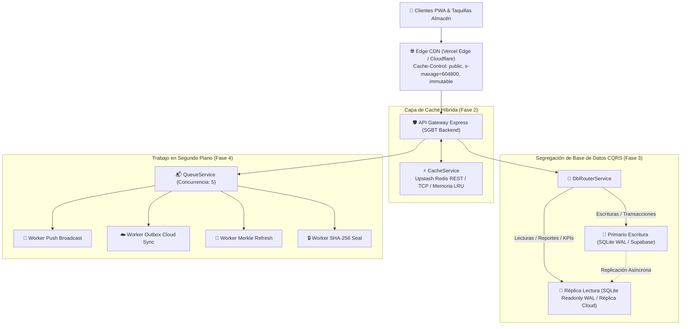

# ADR-0011: Arquitectura de Escalado Horizontal: Edge CDN, Caché Distribuido, Segregación CQRS y Colas Asíncronas

- **Estado:** Accepted
- **Fecha:** 2026-11-15
- **Decisores:** Arquitectura TI, Infraestructura & DevOps (MIPPCI)
- **Consultados:** Dirección General de Gestión Humana, Operaciones de Almacén y Auditoría Interna
- **Contexto Técnico:** Alta Disponibilidad, Desacoplamiento de Carga y Resiliencia en Jornadas Masivas de Despacho Institucional

---

## 1. Contexto y Problemática

El Sistema de Gestión de Beneficios a Trabajadores (SGBT) atiende a miles de funcionarios públicos durante jornadas concentradas de entrega de beneficios alimenticios. Durante estas ventanas de alta demanda operativa, el sistema enfrenta patrones de tráfico con características críticas:

1. **Picos Masivos de Lectura Simultánea:**
   - Cientos de beneficiarios consultan simultáneamente su carnet digital, cuotas asignadas y estatus de despacho.
   - Los monitores de supervisión, taquillas de almacén y tableros ministeriales realizan consultas analíticas pesadas (KPIs de asistencia, cómputo de combos entregados por mesa, reportes de excepción).
   - Ejecutar estas lecturas directamente contra el nodo primario de base de datos generaba contención de I/O en SQLite y saturación de conexiones en el backend.

2. **Operaciones Pesadas Bloqueantes en el Hilo Principal:**
   - La emisión de notificaciones Web Push VAPID cifradas (RFC 8291/8292) a grupos masivos de trabajadores introduce latencias de red externa con los servidores FCM/Mozilla Push.
   - La sincronización asíncrona de eventos outbox hacia Supabase Cloud y el recálculo criptográfico de sellos SHA-256 / ramas del Árbol Merkle generaban esperas innecesarias en las respuestas HTTP de los despachadores.

3. **Restricciones de Entorno Serverless y Edge (Vercel):**
   - En despliegues edge/serverless, las instancias de backend son efímeras y no comparten memoria de proceso.
   - Se requería una estrategia de caché que pudiera funcionar sin fricción en desarrollo local (memoria de proceso / LRU con TTL) y escalar horizontalmente en la nube mediante Upstash Redis (HTTP REST) o clústeres Redis estándar (TCP), sin dependencias rígidas ni riesgo de caídas si la red remota falla.

---

## 2. Decisión de Arquitectura

Se acuerda implementar un modelo de **Escalabilidad Horizontal en Cuatro Fases Integradas**, desacoplando el estado, segregando las rutas de lectura/escritura y delegando el trabajo pesado a una infraestructura de colas asíncronas:

### 2.1 Fase 1: Desacoplamiento de Estado y Optimización Edge CDN
- **Activos Estáticos Inmutables:** Los artefactos frontend generados (JavaScript, CSS, WebAssembly, fuentes, imágenes e iconos) incorporan cabeceras `Cache-Control: public, max-age=31536000, immutable`.
- **Estrategia Stale-While-Revalidate:** Las páginas HTML y manifiestos de la PWA incorporan directivas `public, max-age=0, s-maxage=600, stale-while-revalidate=86400`, garantizando entrega instantánea desde el PoP del CDN más cercano y revalidación en segundo plano.
- **Protección Estricta Anti-Caché en APIs Transaccionales:** Todas las rutas `/api/v1/*` emiten de forma mandatoria `Cache-Control: no-store, no-cache, must-revalidate, proxy-revalidate`, previniendo que respuestas con datos sensibles de beneficiarios o inventario queden almacenadas en cachés intermedias.
- **Configuración de Cabeceras Vercel:** Centralización en `vercel.json` de reglas declarativas de cabeceras de borde para producción.

### 2.2 Fase 2: Capa de Caché Distribuido Híbrida (`cache.service.js`)
- **Adaptador Multi-Driver:**
  1. *Upstash Redis REST:* Activado automáticamente ante la presencia de `UPSTASH_REDIS_REST_URL` y `UPSTASH_REDIS_REST_TOKEN`, óptimo para funciones serverless sin agotar pools de conexiones TCP.
  2. *Redis TCP Estándar:* Activado mediante `REDIS_URL` para despliegues en contenedores Docker o Kubernetes.
  3. *Fallback en Memoria Local:* Almacén en proceso con control de TTL milimétrico y barrido periódico de claves vencidas, asegurando operatividad inmediata en desarrollo, testing y escenarios de contingencia offline.
- **Patrón Cache-Aside Asistido (`wrap`):** Implementación del método `wrap(key, ttlSeconds, fetcherFn)` para orquestar la consulta a la caché y la ejecución de la función de origen con auto-populación transparente.
- **Inyección en Controladores de Alto Tráfico:**
  - `admin.controller.js`: KPIs operacionales (`sgbt:kpis:summary`, TTL: 30s) y catálogo de combos (`sgbt:combos:all`, TTL: 120s).
  - `campaigns.controller.js`: Puntos de distribución (`sgbt:dist_points:active`, TTL: 300s) y listado de jornadas (`sgbt:campaigns:list`, TTL: 60s).
  - `ministerial_audit.controller.js`: Estadísticas del monitor ministerial (`sgbt:ministerial:stats`, TTL: 30s).
- **Invalidación Proactiva de Claves:** Todo evento de mutación (creación de combos, asignación de mesas, despacho de bulto o cierre de jornada) ejecuta `invalidatePattern('sgbt:*')` eliminando riesgo de lecturas inconsistentes (*stale reads*).

### 2.3 Fase 3: Segregación CQRS en Base de Datos (`db_router.service.js`)
- **División de Rutas de I/O:**
  - `dbWrite`: Conexión primaria con privilegios de lectura y escritura en modo WAL (*Write-Ahead Logging*).
  - `dbRead`: Conexión secundaria explícita con bandera `readonly: true` abierta contra la réplica o la misma base en WAL (que permite múltiples lectores concurrentes sin bloquear al escritor).
- **Métodos Especializados:**
  - `queryRead(sql, params)` y `getRead(sql, params)`: Enrutan de manera estricta consultas analíticas pesadas (exportación de nóminas, conteos de auditoría, lectura de combos) a la réplica de solo lectura.
  - `queryWrite(sql, params)` y `transactionWrite(fn)`: Enrutan inserciones, actualizaciones y transacciones ACID atómicas al nodo primario de escritura.
- **Telemetría de Enrutamiento:** Registro de contadores de operaciones (`readsRouted`, `writesRouted`) y verificación de latencia en milisegundos (`checkLatency()`).

### 2.4 Fase 4: Colas Asíncronas y Background Workers (`queue.service.js`)
- **Motor Ligero de Mensajería en Memoria/Persistente:**
  - Control de concurrencia configurable (por defecto 5 trabajadores paralelos).
  - Estrategia de reintentos exponenciales con jitter (`maxRetries = 3`, `backoffBase = 1000ms`).
  - Detección y contabilidad de trabajos diferidos (`delayedJobs`) y método `drain()` para garantizar apagado elegante (*graceful shutdown*) e inmunidad a condiciones de carrera en tests automatizados.
- **Handlers Especializados Registrados:**
  1. `PUSH_BROADCAST`: Encolamiento y emisión de notificaciones Web Push VAPID sin bloquear el endpoint de despacho.
  2. `OUTBOX_SYNC`: Despacho en lotes de eventos locales hacia Supabase Cloud en segundo plano.
  3. `AUDIT_MERKLE_REFRESH`: Recálculo asíncrono de raíces de Árbol Merkle ante inserción de lotes masivos.
  4. `GENERATE_ACTA_SEAL`: Generación de sellos criptográficos SHA-256 sin penalizar al usuario final.
- **Supervisión de Salud y API de Diagnóstico:**
  - `GET /api/v1/system/queue/status`: Exposición de longitud de cola, trabajos activos, fallidos, completados y tasa de éxito.
  - `POST /api/v1/system/queue/drain`: Drenado forzado administrativo con autorización requerida.
  - `GET /api/v1/system/db/routing`: Estadísticas de enrutamiento CQRS y latencias por nodo.
  - `GET /api/v1/system/status`: Enriquecido con telemetría de caché, base de datos y colas.

---

## 3. Consecuencias

### Positivas
- **Aceleración Drástica de Tiempos de Respuesta:** Respuestas de KPIs y catálogos reducidas de ~80-120 ms a < 2 ms bajo caché caliente.
- **Eliminación de Bloqueos en Mesa de Despacho:** Los operadores de almacén experimentan confirmaciones inmediatas al delegar tareas de I/O de red externa (Web Push, Cloud Sync) a los workers asíncronos.
- **Aislamiento de Carga en Base de Datos:** Las consultas analíticas de auditoría y exportación de nómina ya no interfieren con las transacciones de entrega en vivo gracias a la réplica de solo lectura en SQLite WAL.
- **Tolerancia a Fallos y Reintentos Automáticos:** Caídas temporales de red hacia servicios externos (servidores de Web Push o Supabase) se recuperan automáticamente mediante la cola con backoff exponencial sin pérdida de transacciones.
- **Portabilidad Serverless y On-Premise:** El sistema opera idénticamente en instancias de desarrollo local, servidores locales de almacén sin internet, y contenedores en la nube con clúster Redis.

### Mitigaciones y Consideraciones
- **Eventual Consistency:** La réplica de lectura y la caché introducen una ventana mínima de consistencia eventual. Se mitiga mediante invalidación proactiva inmediata tras toda mutación y obligatoriedad de `dbWrite` para flujos transaccionales de retiro.
- **Gestión de Memoria en Colas:** Si el backend procesa ráfagas extremas en memoria sin Redis persistente, un reinicio abrupto del proceso podría perder trabajos en cola no completados. Se mitiga mediante la persistencia en la tabla `outbox_events` que reintenta la sincronización tras el reinicio.

---

## 4. Alternativas Consideradas

| Alternativa | Veredicto | Motivo del Descarte |
| :--- | :---: | :--- |
| **RabbitMQ / Apache Kafka** | Descartado | Sobrecarga de infraestructura excesiva para el despliegue ligero del MIPPCI; requiere clústeres dedicados y puertos especiales incompatibles con serverless. |
| **BullMQ con Redis Obligatorio** | Descartado | Dependencia estricta de un servidor Redis activo 100% del tiempo; inutiliza la capacidad del sistema de operar en almacenes con servidores locales portátiles sin dependencias externas. |
| **Escritura y Lectura en Primario Único** | Descartado | Riesgo severo de cuellos de botella y contención en jornadas masivas con más de 1.500 funcionarios consultando simultáneamente. |
| **Caché en Frontend Exclusivamente** | Descartado | No resuelve la sobrecarga de consultas generadas por diferentes dispositivos ni garantiza invalidación sincronizada ante mutaciones de inventario. |
